<div align="center">


# Tweedekanshoek

**Know when your IKEA furniture shows up in the second-chance corner — and whether the drive is worth it.**

[www.tweedekanshoek.nl](https://www.tweedekanshoek.nl) · Dutch interface · NL · BE · DE

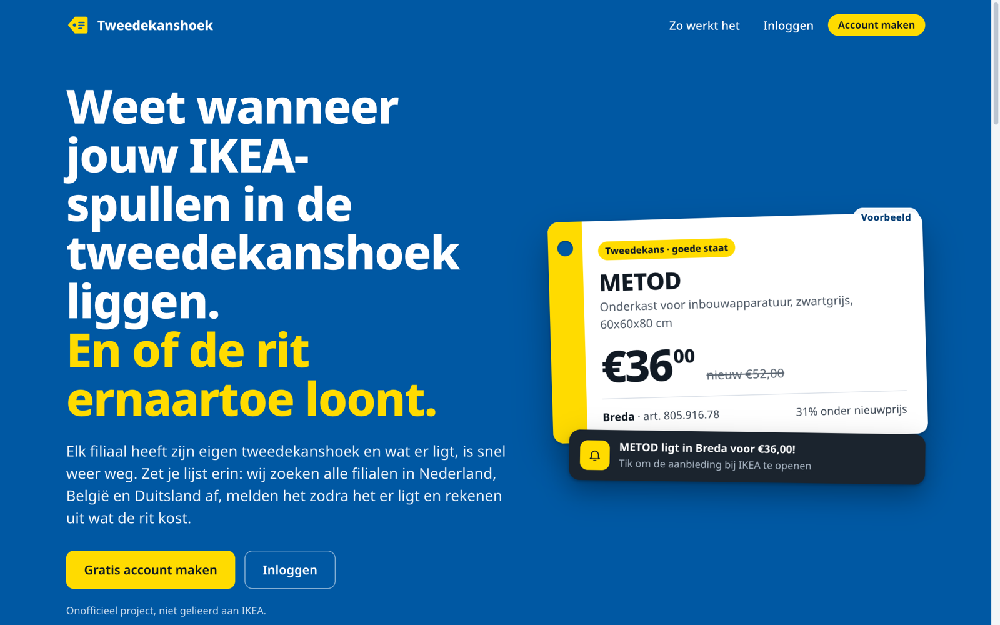

</div>

> **Unofficial project.** Tweedekanshoek is an independent tool. It is not affiliated with, sponsored by or endorsed by IKEA. Reserving and buying always happens at IKEA itself.

## Why

IKEA's _Tweedekanshoek_ (second-chance corner: returns, ex-display, buy-backs) is listed **per store**, changes constantly and sells out fast. Finding the one METOD cabinet you need means checking dozens of store pages — and then deciding whether a 90-minute drive saves enough money.

Tweedekanshoek fetches the offers of **all stores** in the Netherlands, Belgium and Germany, tracks prices over time, tells you the moment something from your list shows up, and calculates whether the trip pays off.

## Features

### Watchlist and shopping lists

Put any product from IKEA's full catalogue on your watchlist, or build shopping lists per room (kitchen, wardrobe, bedroom). Import a list from text (`2x 802.045.62`), set quantities, tick pieces off with the price you paid, and get a receipt-style total with how much you saved against the new price.

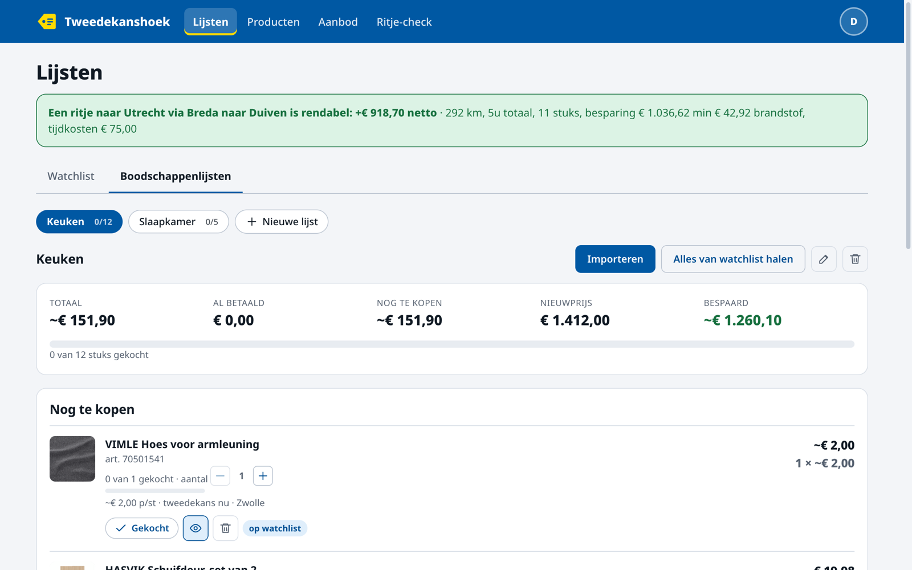

### Alerts when it appears

Follow the stores you can reach. When a watchlist product lands in a followed store you get a notification that opens the exact offer at IKEA. Choose your channel: **push (ntfy)**, **e-mail**, **Home Assistant**, or the **Android app**. Every alert says how the price compares: _lowest price so far_ or _+€2.50 above the lowest earlier price_.

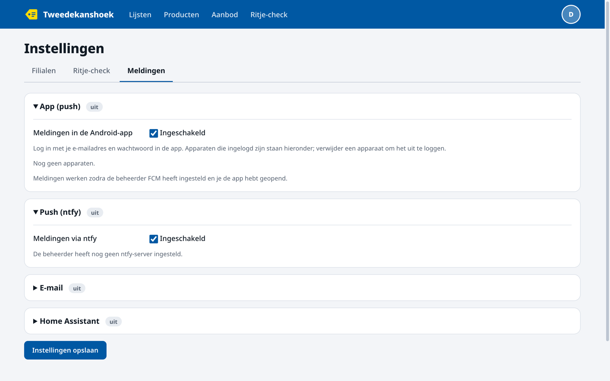

### Browse every offer

All second-chance offers of all stores in one searchable list, with filters (store, followed stores, new in the last 24 h / 3 d / 7 d) and sorting (newest, price, biggest discount).

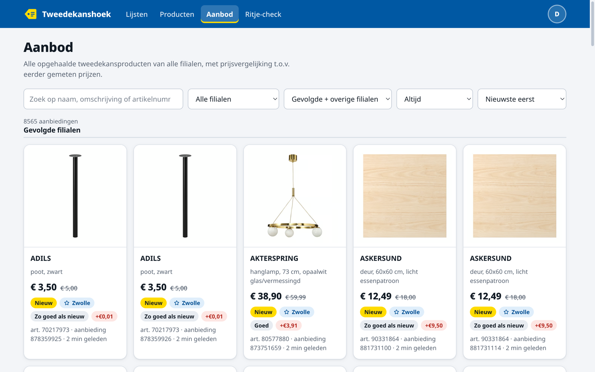

### Product pages with price history

Every article has its own page: where it is available now, at what price and condition, how long it has been there, and every price ever measured.

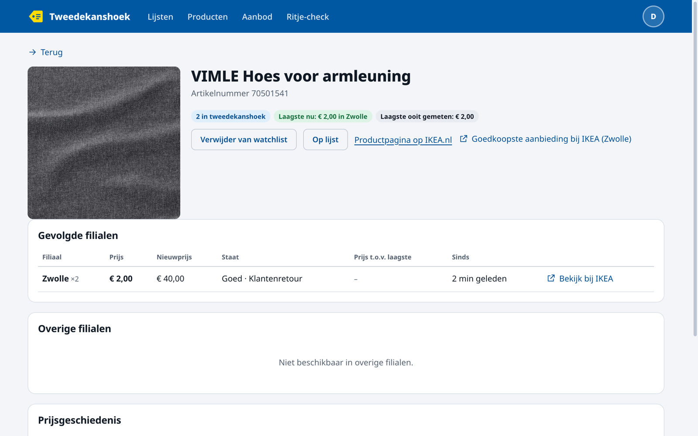

### Trip check

The feature that turns a list into a decision. For your postcode, fuel price, consumption, time per store and the value of your time, it calculates per store **and** for multi-store routes whether the trip is worth it: saving against the new price minus fuel minus time. Green means worth it, orange means worth it in money but not in time. Exclude stores you never visit, cap the number of stops and the maximum trip time, open the route in Google Maps, send it to your phone, and tick off what you picked up.

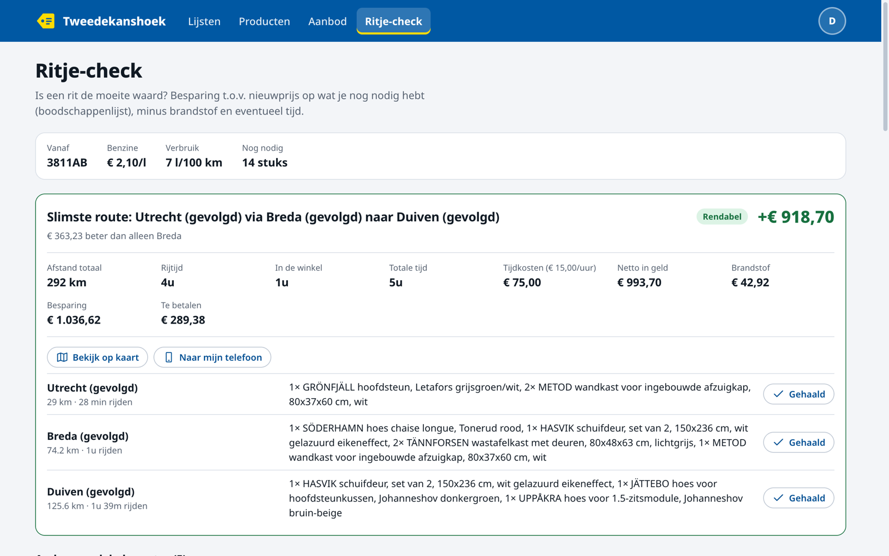

### Multi-user, private by design

Anyone can create an account. Watchlists, lists, purchases, alerts and settings are strictly per user; only the offers and prices are shared. An admin area (`/admin`) offers statistics, user management, notification-type switches, SMTP and fetch status, and lets the admin choose which statistics (if any) are shown publicly on the landing page.

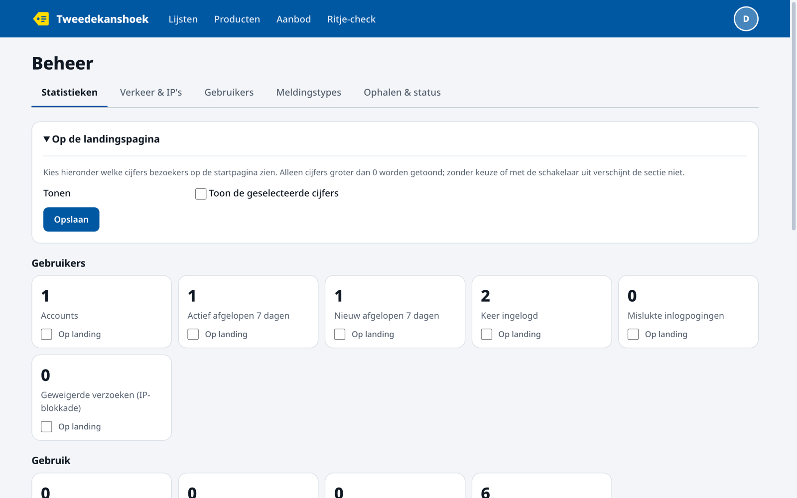

### Works on your phone

The whole site is mobile-first, with a hamburger menu and a design system shared with the Android app.

<table>
  <tr>
    <td>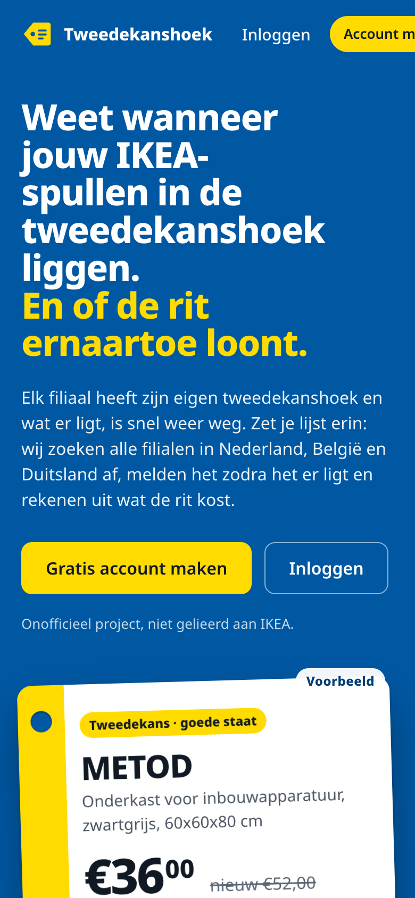</td>
    <td>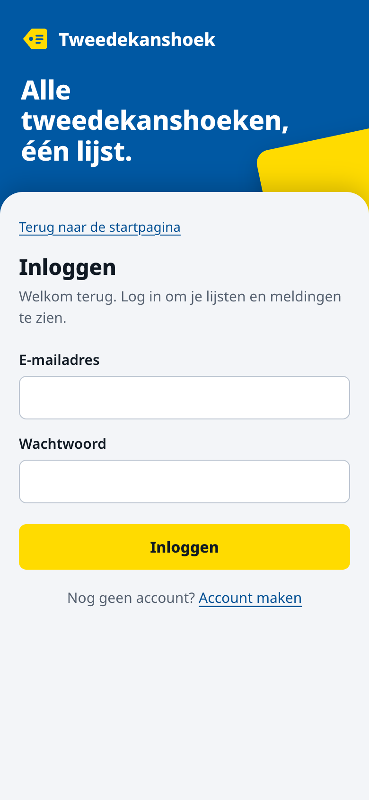</td>
    <td>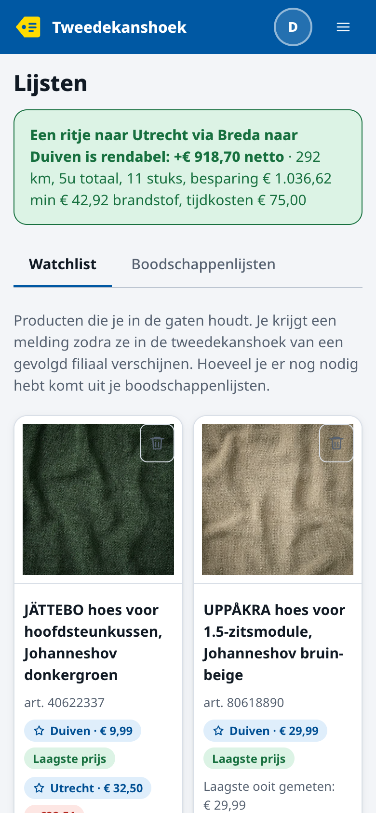</td>
    <td>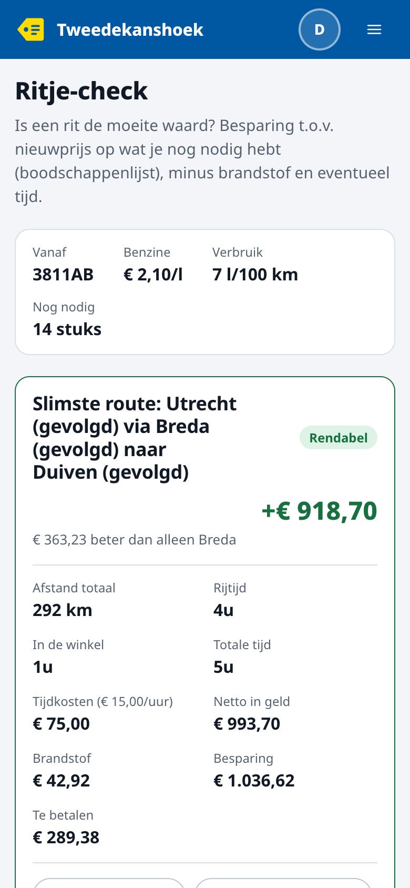</td>
  </tr>
</table>

## Android app

A native Android app lives in [`mobile/`](mobile/) (Expo / React Native, Expo Router). It is in internal testing and not on the Play Store yet.

- Lists, products, offers and trip check with a native feel and light/dark theme
- **Push notifications** via Firebase Cloud Messaging, with separate channels for new offers, price drops and profitable trips
- **Haptic feedback** on bought/follow actions, steppers and tabs (can be switched off)
- Deep links: `tweedekanshoek.nl/product/…` and notification taps open the product
- Per-device login tokens that you can revoke from the website

See [`mobile/README.md`](mobile/README.md) for setup (Firebase, EAS builds).

## How it works

```
IKEA as-is API ──► poller (all stores, every ~15 min) ──► SQLite
                                                           │
        ┌──────────────────────────────────────────────────┤
        ▼                                                  ▼
 price history + alerts ──► ntfy / e-mail / Home Assistant / FCM push
        │
        ▼
 Next.js JSON API (/api/*) ──► web app (React) and Android app
                         └──► trip engine (OSRM routes, PDOK geocoding)
```

- **Offers** come from IKEA's public as-is API and are refreshed centrally for every store, for everyone.
- **Prices** are stored per article in a slim history table, which powers the price tags ("lowest so far", "+€x").
- **Trips** use OSRM for driving distance and time and PDOK for postcode lookups, with a small solver for multi-store routes.
- **Secrets** (SMTP password, Home Assistant token) are encrypted with AES-256-GCM; passwords use scrypt; sessions are HttpOnly cookies, devices use revocable hashed tokens.

## Tech stack

| Area       | Choice                                                                               |
| ---------- | ------------------------------------------------------------------------------------ |
| Web        | Next.js 16 (App Router), React 19, TypeScript (strict)                               |
| Data       | SQLite via better-sqlite3                                                            |
| Validation | Zod                                                                                  |
| Mobile     | Expo SDK 57, React Native, Expo Router, TanStack Query                               |
| Quality    | ESLint (strict type-checked, React, a11y), Prettier, Vitest                          |
| Design     | Hand-built design system (IKEA blue/yellow, Noto Sans), see [`DESIGN.md`](DESIGN.md) |
| Deploy     | Docker, or systemd on Linux (self-hosted behind a reverse proxy)                     |

## Run it yourself

**Docker**

```bash
cp .env.example .env     # set ADMIN_EMAIL, APP_URL, optional SECRET_KEY
docker compose up -d --build
```

**Development**

```bash
pnpm install
pnpm dev                 # http://localhost:3000
pnpm typecheck && pnpm lint && pnpm test
```

The first account you create becomes the admin (set `ADMIN_EMAIL` to restrict who may create it). Full instructions for Docker, the systemd installer, backups/restore, ntfy and the security model are in [`docs/self-hosting.md`](docs/self-hosting.md) (Dutch).

## Project layout

```
src/app/          routes, layouts and the JSON API (route handlers)
src/features/     feature code: lists, catalog, offers, trips, settings, admin, …
src/components/   shared UI and layout
src/server/       domain logic, SQLite access, notifications, poller
mobile/           Android app (Expo)
deploy/           systemd installer, backup/restore, ntfy compose
docs/             self-hosting guide and screenshots
```

## Privacy

Your data is yours: lists, purchases and settings are only visible to your own account, and the app talks to your own server. The Android app never scrapes IKEA; it only uses this server's API. The screenshots in this README use a demo account and show product data from IKEA's public as-is API.

## Disclaimer

IKEA and the names of IKEA products are trademarks of Inter IKEA Systems B.V. This project uses them only to describe the products it tracks. Prices, availability and delivery information come from IKEA's public as-is API and may be out of date; always check at IKEA before you drive.

## License

Licensed under the [GNU Affero General Public License v3.0](LICENSE) (AGPL-3.0-only). You may use, modify and self-host it; if you run a modified version as a network service, you must offer its source code to your users under the same license.

The name **Tweedekanshoek**, the logo and the tweedekanshoek.nl domain are not covered by the license and may not be reused for other services. IKEA names and product data remain the property of their owners; the bundled Noto Sans font is licensed under the SIL OFL (`public/fonts/OFL.txt`).
